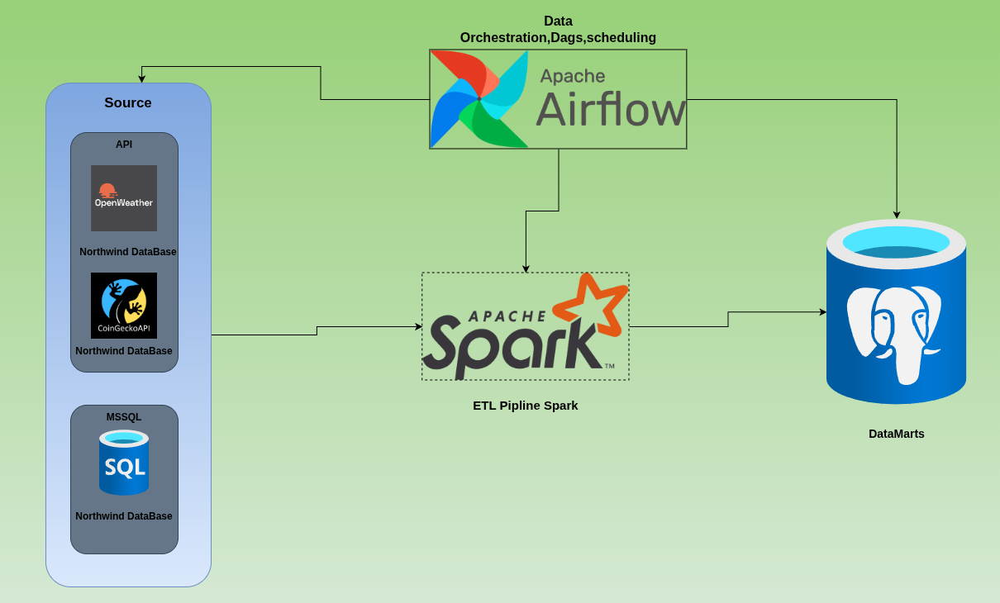

# End-to-End ETL Pipeline with PySpark and Apache Airflow

## Overview

This project implements an end-to-end ETL (Extract, Transform, Load) pipeline that integrates data from multiple heterogeneous sources, including Microsoft SQL Server (MSSQL) and external Application APIs.

The pipeline uses **Python and PySpark** to extract, process, and transform data before loading it into **PostgreSQL**. Apache Airflow is used to orchestrate and manage pipeline execution, including task dependencies and scheduling.

The main objective is to demonstrate a practical Data Engineering workflow for integrating data from multiple sources into a centralized data storage environment.

## Architecture



### Data Flow

1. **Data Extraction**
   - Extract data from Microsoft SQL Server.
   - Retrieve data from external Application APIs.
   - Handle data from different source formats.

2. **Data Transformation**
   - Use Python and PySpark for data processing.
   - Apply data transformation and preparation logic.
   - Prepare datasets for loading into PostgreSQL.

3. **Data Loading**
   - Load transformed datasets into PostgreSQL.
   - Organize processed data in the target database.

4. **Workflow Orchestration**
   - Use Apache Airflow to orchestrate ETL workflows.
   - Define task dependencies and execution order.
   - Schedule and monitor pipeline execution.

## Technology Stack

| Technology | Purpose |
|---|---|
| Python | ETL development and API integration |
| PySpark | Data processing and transformation |
| Microsoft SQL Server | Source database |
| Application APIs | External data sources |
| PostgreSQL | Target database |
| Apache Airflow | Workflow orchestration |
| SQL | Data extraction and database operations |
| Git & GitHub | Version control |

## Project Structure

```text
ETLPiplines/
│
├── SQL_queries/
│   └── SQL scripts for data extraction
│
├── pythonCode/
│   └── Python and PySpark ETL scripts
│
├── ETL&ELTDiagram.png
│
└── README.md
```

## Key Features

- Integration of multiple heterogeneous data sources.
- Extraction of data from relational databases and external APIs.
- Data transformation using PySpark.
- Centralized data storage in PostgreSQL.
- Workflow orchestration using Apache Airflow.
- Modular ETL development using Python.
- Automated pipeline execution and task dependency management.

## Project Goals

This project focuses on demonstrating practical Data Engineering skills, including:

- Building ETL pipelines from multiple data sources.
- Working with relational databases and external APIs.
- Processing and transforming data with PySpark.
- Designing data integration workflows.
- Managing ETL execution through Apache Airflow.
- Working with PostgreSQL as a centralized data storage platform.

## Future Improvements

Potential improvements and extensions include:

- Implement incremental data loading strategies.
- Introduce data quality validation and consistency checks.
- Implement structured logging and error handling.
- Add retry mechanisms and failure notifications.
- Containerize the infrastructure using Docker and Docker Compose.
- Implement automated testing for ETL transformations.
- Add monitoring and pipeline execution metrics.

## Author

**Giorgi Megeneishvili**

Data Developer | Data Engineering

- GitHub: [GiorgiMegeneishvili](https://github.com/GiorgiMegeneishvili)

---

*This project is part of my ongoing Data Engineering portfolio, focused on building practical ETL solutions and working with modern data engineering technologies.*
